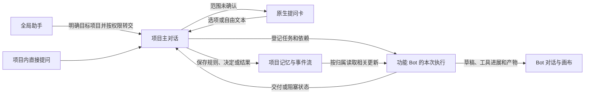
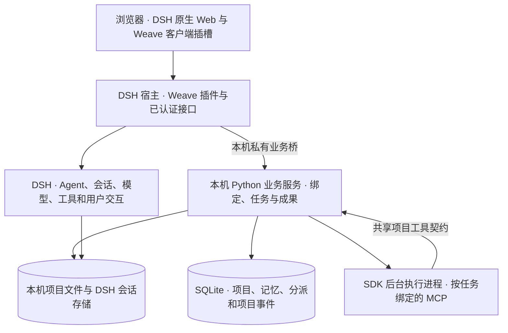

# Weave

**Weave 是一个本地优先、由 AI 助手协作的通用项目工作区。** 把对话、项目资料、任务、决策和交付物放在同一个项目里，工作暂停后可以从原会话和已保存的成果继续。

科研是 Weave 的主要落地场景，已接入多源论文检索、证据关系、实验跟踪和阶段确认。同一套项目、Bot 和任务机制也能用来梳理产品需求、组织知识、检查代码或跟踪数据分析。

## 快速启动

需要 Python 3.12。首次安装固定依赖需要联网。浏览器前端由打包的 DSH 运行时提供，启动应用无需单独安装 Node.js 或构建前端。克隆资料仓库和查看 Git 信息时，本机需要 Git。

| 系统 | 从仓库根目录运行 |
| --- | --- |
| Windows | `.\start.ps1` |
| Linux | `bash start.sh` |

启动器在仓库的 `.venv` 准备环境，随后打开本机浏览器。首次进入「配置模型 API」时选择供应商并填写 API Key。也可以稍后在「模型与 API」中配置。

| 启动参数 | 用途 |
| --- | --- |
| `--no-open` | 在终端显示当次本机登录链接，由用户选择浏览器。 |
| `--port 8770` | 设置 Web 端口，默认监听 `127.0.0.1:8770`。启动器另使用本机 8765 管理业务实例。 |
| `--stop` | 关闭此仓库启动的 Weave 服务。前台进程也可以用 Ctrl+C 退出。 |
| `--install-only` | 只安装运行依赖。安装输出保存在 `.venv/weave-install.log`。 |
| `--backup`、`--restore <备份.zip>` | 停止服务后备份或恢复项目数据和原生会话。 |

## 核心概念

| 概念 | 负责什么 |
| --- | --- |
| 全局助手 | 管理跨项目事务，维护全局记忆，把执行请求转交给用户明确指定的项目。顶部「新对话」开启新的全局会话。 |
| 项目 | 承载工作目录、资料、规则、记忆、Bot、分派和交付记录，也是权限及引用校验的作用域。 |
| 项目主对话 | 理解任务、澄清范围、协调分工、处理依赖和验收结果。查阅已有项目资料可以直接完成。 |
| 功能 Bot | 项目里长期存在的工作单元，保存名称、职责、范式、独立对话、画布和成果。一个项目可以按需创建多个同范式 Bot。 |
| Bot 范式 | 定义一类 Bot 的数据字段和呈现方式。内置目标、笔记、思维导图、点子、工程台，也可以在项目内定义派生范式。 |
| 任务分派 | 把一次执行请求关联到发起会话、承接 Bot、范围、验收条件、依赖和交付。运行与结束状态可在「项目任务」中追溯。 |
| Agent 与子智能体 | DSH 驱动模型、工具和事件的执行实例。项目主对话分派工作时，宿主启动与该任务和 Bot 绑定的原生子智能体。 |
| 会话与事件日志 | DSH 持久化对话和执行轨迹。Weave 从相关事件和分派记录呈现任务进度、结果及 Bot 对话流。 |
| Tool、MCP、Skill、SDK | Tool 是带参数和结果的一次操作。MCP 连接工具提供端。Skill 描述何时做、怎样做和如何验收。Python SDK 将 DSH 接入后台任务。 |

新项目从「聊天」开始。点击项目旁的「＋」可以添加 Bot，项目设置可以关联本机来源文件夹。关联来源留在原路径，并通过项目只读入口读取。输入框的 `@` 用于邀请发言者或引用同作用域的对话、资料与任务，`/` 提供当前入口的导航和指令。

## 工作流与上下文



- **确认与授权。** 推进意图、缺少的关键信息以及后续阶段的用户决定可在 DSH 原生提问卡中收集。用户可以选择或自由输入。跳过必要信息或暂停时，本轮停在已确认范围。文件或命令权限继续由会话的访问模式与原生审批控制。
- **共享项目知识。** 主对话和同项目 Bot 共享可检索的项目资料、规则、决定与成果。每个 Bot 保有自己的对话。分派运行接收本次任务、相关上下文与前置成果，并在下一执行步骤读取有权限的项目更新。
- **组织执行。** 独立任务可以并行，有依赖的任务等待前置交付。项目主对话核对实际执行状态，Bot 可在完成前保存待核验草稿和文件引用。临时 Bot 完成且满足归档条件后可以归档，历史交付可回查。
- **观察结果。** 侧栏用蓝点显示进行中、绿点显示未读完成、红点显示失败。完成时右下角提示可回到对应对话。Bot 对话展示任务输入、工作进展、交付和跟进，以实际动作和结论描述成果。

## Bot 画布与交付

每个 Bot 保存一种主排布。范式可采用清单、路径、时间线、星形、总线、关系图或矩阵等与数据相匹配的结构。可以添加根节点、从已有节点添加分支，以及删除单个内容节点。分支和前置依赖显示方向，普通关联用虚线显示。关系由保存的项目记录驱动，服务会检查作用域和方向关系中的环。

| 范式 | 可保存的成果 | 使用示例 |
| --- | --- | --- |
| 目标 | 验收条件、截止时间、子任务、进度和依赖 | 发布计划、阶段里程碑 |
| 笔记 | 有来源的记录、文档和时间线 | 用户反馈、会议记录、文献摘要 |
| 思维导图 | 可核查的关系节点、分支和依赖 | 模块依赖、证据关系 |
| 点子 | 问题、假设、待验证方案和来源 | 产品假设、研究方向 |
| 工程台 | 执行状态、日志、指标和产物 | 脚本验证、数据分析、实验对照 |

内容详情可以同时包含 Markdown、图片、链接、文件和可交互图表。已保存的结构化数据和可预览的 CSV/TSV 可以呈现折线、柱状或散点图。工程台能展示已记录的指标和运行曲线，具体数据取决于执行程序提供的指标与产物。

项目对话右侧「工具 → 空间存储」按时间整理可打开的文件。项目生成的交付物写在本项目的 `outputs/` 下。工具区也可以查看工作区文件和 Git 信息，并使用会话权限允许的原生工具。

## 科研应用

`research-project-loop` 按当前科研请求选择需要的阶段。已有明确范围的单步任务可以直接处理。涉及扩大范围、改变研究方向或开始实际实验时，流程通过原生提问卡确认下一步。执行中的子智能体把需要用户决定的问题交回项目主对话。

1. **查找与核对。** 从项目资料或公开索引定位论文，核对 DOI、版本、原文和可复查的位置。
2. **整理关系。** 在笔记和导图记录支持、反驳、依赖及尚待验证的证据。
3. **形成假设与目标。** 写明验证问题、可交付结果、验收条件和停止条件。
4. **执行与反馈。** 工程台记录实际运行、指标、曲线和产物。验收时将新结果关联回受影响的目标、假设与证据。

论文搜索支持 Crossref、OpenAlex、arXiv 和 Europe PMC，默认使用 Crossref 和 OpenAlex。结果按 DOI 或 arXiv 标识合并并保留来源。OpenAlex 支持通过 `OPENALEX_API_KEY` 配置访问。DOI 引用列表、OpenAlex 引用邻居与项目 PDF 的按页读取分别提供不同粒度的证据。动态订阅的论文、新闻与仓库来源由其各自的采集入口处理。

## 技术架构



- **启动与配置。** Python 3.12 启动器启用固定的 DSH SDK/runtime `0.2.2rc2`。它准备该数据目录的 Web profile，在本机启动 DSH 与 Python 业务桥，并管理后台调度和退出。浏览器接入 DSH 的原生会话、设置、模型选择和主题。
- **界面与宿主。** Weave 的 JavaScript 客户端通过 DSH 插槽渲染项目导航、Bot 工作台、任务面板与空间存储。宿主通过 `/api/labweave/` 提供已认证的同源接口，注册原生工具，并在真正运行的 Agent 上校验会话、工作区和权限。
- **应用与持久化。** Python 层负责项目与 Bot、资料和文件、项目记忆、任务状态、关系边和图表数据。SQLite 保存结构化业务记录和项目事件。DSH 保存原生会话日志，项目目录保存文件产物，稳定标识将两类记录关联起来。
- **执行与扩展。** 浏览器对话通过 DSH 原生 Agent 执行，后台任务通过 Python SDK 接入 DSH。两条路径复用项目工具契约，前者由宿主注册 `labweave_*` 工具，后者通过固定作用域的 MCP 暴露。常规 SDK 路径使用 stdio，Windows 可由任务进程适配为私有本机 HTTP。第三方工具连接、可执行插件与项目内保存的一段可复用指令各有自己的入口和权限。

| 代码位置 | 入口 |
| --- | --- |
| [统一启动器](scripts/native_launcher.py) | 本机 profile、依赖启动、业务桥、后台任务和停止流程 |
| [Weave 客户端](plugins/dsh-labweave-workspace/client/index.js) | 原生 UI 插槽、Bot 画布、对话与项目交互 |
| [Weave 宿主](plugins/dsh-labweave-workspace/host/native.js) | 同源接口、作用域校验、工具和运行时接入 |
| [分派](plugins/dsh-labweave-workspace/host/bot-delegation.js) 与 [项目事件流](demo/api/project_flow.py) | 子智能体、依赖检查、可追溯交付和共享更新 |
| [业务桥](demo/api/native_web.py) 与 [MCP 工具](demo/api/research_mcp.py) | 项目业务操作及 SDK 共享工具契约 |
| [科研方法](skills/) 与 [范式 Skill](plugins/dsh-labweave-workspace/research-skills/) | 专项工作流、方法和交付要求 |

## 数据、访问与备份

| 数据 | 默认位置 |
| --- | --- |
| 工作区数据库 | `demo/.local/workspace.sqlite3` |
| 项目资料、仓库及交付文件 | `demo/.local/projects/<project_id>/`，生成文件写入项目的 `outputs/` |
| 全局助手的工作目录 | `demo/.local/web-global/` |
| 原生 Web 会话与设置 | Windows 位于 `%LOCALAPPDATA%\LabWeave\web\<数据目录标识>`，Linux 位于 `${XDG_STATE_HOME:-$HOME/.local/state}/LabWeave/web/<数据目录标识>` |
| 早期 SDK 会话与备份 | `demo/.local/dsh-home/` 和 `demo/backups/` |

`proj_<标识>` 是稳定目录键，项目改名只改显示名称。资料引用、项目对象和分派记录通过稳定 ID 追溯。原生会话包含绝对工作目录，带会话的备份应恢复到原数据目录。恢复前会生成回滚备份。模型凭据、虚拟环境和依赖缓存由目标环境单独配置。

本机存储与外部模型调用是两个边界。模型、文献检索与仓库克隆由相应服务处理。项目作用域用于校验业务操作与引用，命令的系统级隔离依赖 DSH 权限配置和实际操作系统后端。后台任务依赖本机服务持续运行。扫描 PDF 的文字识别、跨设备同步和远程实验调度需要在工作区之外处理。

## 验证

在仓库根目录安装运行依赖后，Windows 使用以下命令。Linux 将解释器路径换为 `.venv/bin/python`。

```powershell
.venv/Scripts/python.exe -m unittest discover -s tests
node --test tests/test_*.cjs
```

浏览器测试使用 Node.js 24 与仓库锁定的 Playwright。运行 `npm ci` 后，Windows 默认使用 Edge，Linux 可以用 `npx playwright install chromium` 安装 Chromium 并设置 `PLAYWRIGHT_CHANNEL=chromium`。

| 验证内容 | 入口 |
| --- | --- |
| 工作区、项目工具与兼容性 | [原生 Web 集成](tests/integration_native_web.py)，可加 `--rightbar-only` 检查项目工具 |
| 原生提问、并行分派、Bot 画布及跟进 | [Bot 分派浏览器测试](tests/integration_bot_delegation.py)，使用固定版 DSH 和模拟模型 |
| 真实模型、审批和问答 | [运行时](tests/integration_runtime.py)、[审批](tests/integration_approval.py)、[问答](tests/integration_question.py)；需要可用的模型配置 |
| 端到端科研示例 | [科研验收案例](tests/research_case.py)，用论文和源代码验证参数量核算、记录和恢复 |

## 进一步阅读

- [使用指南](docs/Weave项目介绍与功能说明.md)涵盖项目设置、资料、任务和日常操作。
- [开发基线与接口地图](docs/开发基线与接口地图.md)说明 HTTP、MCP、SDK 和主要代码入口。
- [Bot 与项目上下文](docs/Bot与项目上下文需求.md)说明工作流、画布关系和验收。
- [Weave 的 DSH 前端适配](docs/DSH前端适配路线.md)和[助手命名与作用域隔离](docs/名称与隔离实现.md)记录固定内核的集成和绑定。
- [功能 Bot 与项目执行](docs/功能Bot与项目代码沙盒设计.md)和 [DSH 运行时验收](docs/dsh-runtime-validation.md)说明执行边界及验证范围。
